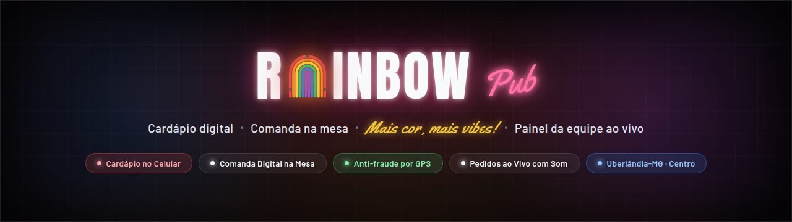
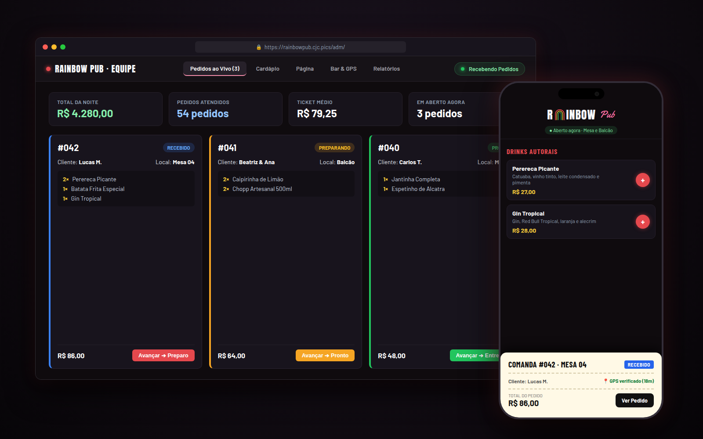
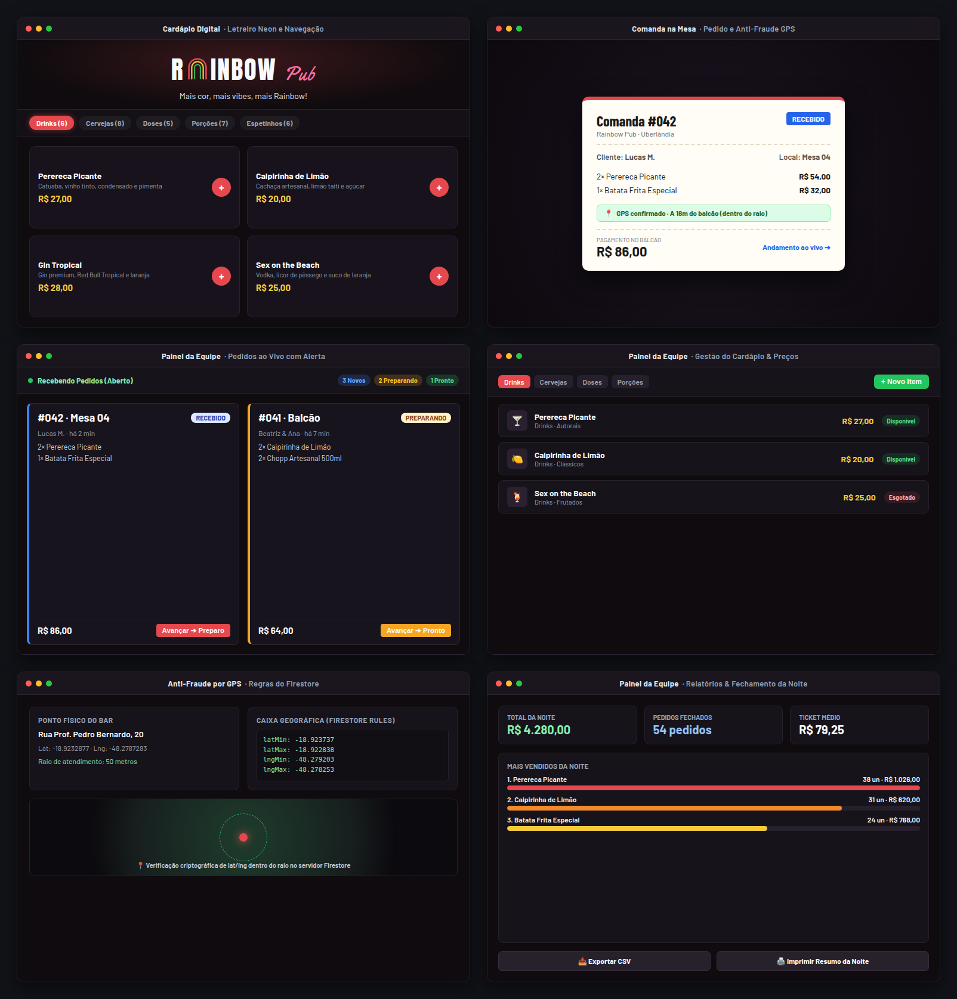

<p align="center">
  
</p>

<p align="center">
  
  <a href="https://rainbowpub.cjc.pics/"></a>
  <a href="https://rainbowpub.cjc.pics/adm/"></a>
  
  
  
  
  
</p>

<p align="center">Cardápio digital pelo celular, comanda e pedido direto da mesa com validação por GPS, e painel administrativo em tempo real para a equipe do bar.</p>

<p align="center">
  
</p>

### 📸 Telas do sistema

<p align="center">
  
</p>

---

Sistema web completo de atendimento e gestão para o **Rainbow Pub** (Rua Professor Pedro Bernardo, 20 · Centro · Uberlândia-MG):
o cliente consulta o cardápio pelo celular, monta sua comanda e faz o pedido direto da mesa, enquanto o sistema valida por GPS se ele está fisicamente dentro do bar. No balcão, a equipe acompanha os pedidos em tempo real com alertas sonoros, gerencia o cardápio e emite relatórios de fechamento da noite.

Funciona 100% no navegador, sem necessidade de baixar aplicativo em loja, sem framework pesado e com sincronização instantânea via Firebase Firestore.

---

## ⚡ Como funciona

| Recurso | Detalhes |
|---|---|
| 🌈 **Letreiro Neon Vivo** | O arco da letra "A" do logo é um neon com 6 tubos coloridos que acendem progressivamente de fora para dentro. Cada faixa do arco corresponde a uma seção do cardápio e funciona como navegação direta. |
| 📋 **Comanda de Mesa** | O carrinho replica a comanda de papel tradicional do balcão. O cliente digita seu nome e onde está sentado (mesa, balcão, sinuca); ao enviar, o pedido ganha um carimbo com o número (`#042`) e o andamento ao vivo (*Recebido* ➔ *Preparando* ➔ *Pronto* ➔ *Entregue*). O acerto financeiro continua sendo feito presencialmente no balcão. |
| 📍 **Anti-Fraude por GPS Duplo** | O pedido só sai se o smartphone estiver dentro do raio físico estipulado para o bar (ex.: 50 m). A validação ocorre primeiro no navegador (fórmula de Haversine) e é conferida novamente no servidor pelas regras de segurança do Firestore (caixa delimitadora de `lat`/`lng`), impossibilitando pedidos forjados fora do local. |
| 🔔 **Painel ao Vivo da Equipe (`/adm/`)** | Interface operacional para a noite: pedidos organizados por status, alerta sonoro para novas comandas, interruptor mestre *"Recebendo pedidos"*, gestão de preços e fotos em base64, e relatórios por noite com exportação CSV e recibo térmico. |

---

## 📱 Módulos do Sistema

### 1. Cardápio Público (`/`)
- **Seções em Neon**: Drinks Autorais, Cervejas & Chopp, Doses & Shots, Porções & Petiscos, Espetinhos e Jantinha.
- **Identidade Visual dos Drinks**: Ilustrações vetoriais de copos com gradientes dinâmicos calculados para cada drink (ex.: Perereca Picante, Caipivodka, Gin Tropical).
- **Status do Bar**: Verificação automática de horário de funcionamento (`Aberto agora · até 03h`, `Abre hoje às 19h` ou `Fechado`).
- **Comanda Integrada**: Adição e remoção de itens com cálculo de subtotal em tempo real, sem recarregar a página.

### 2. O Rainbow / Institucional (`/sobre/`)
- Manifesto de acolhimento e resistência LGBTQIA+.
- Galeria de fotos da casa com visualização ampliada.
- Horários de funcionamento detalhados por dia da semana.
- Mapa interativo com botão de rota direta para o Google Maps e link para o Instagram oficial [@rainbowpubudi](https://www.instagram.com/rainbowpubudi/).

### 3. Painel Administrativo da Equipe (`/adm/`)
Acesso protegido por autenticação via Firebase Auth, bloqueado para indexação (`robots.txt` e `<meta name="robots" content="noindex, nofollow">`).

- **Pedidos ao Vivo**:
  - Painel estilo Kanban simplificado com status coloridos (*Recebido* em azul, *Preparando* em âmbar, *Pronto* em verde, *Entregue* e *Cancelado*).
  - Alerta sonoro configurável ao receber novos pedidos.
  - Botão de ação rápida para avançar a comanda para a próxima etapa em um clique.
  - Alerta de divergência caso o preço do cardápio tenha mudado após o envio do pedido.
  - Interruptor global para ligar/desligar o recebimento de pedidos instantaneamente.
- **Gestão do Cardápio**:
  - Cadastro e edição de produtos, categorias, preços e descrições.
  - Alternador de disponibilidade (*Disponível* / *Esgotado*) com reflexo imediato no cardápio público.
  - Upload de fotos direto pelo navegador: as imagens são redimensionadas em canvas e gravadas em WebP/base64 direto no documento do Firestore, sem necessidade de bucket de Storage.
  - Ordenação personalizada dos itens por arrastar ou botões de ordem.
- **Bar & Cerca GPS**:
  - Configuração do ponto geográfico oficial do bar (latitude e longitude) e do raio de cobertura em metros.
  - Cálculo automático da caixa delimitadora (`latMin`, `latMax`, `lngMin`, `lngMax`) para abastecer as regras de segurança do banco.
  - Definição dos horários de abertura e fechamento para cada dia da semana.
- **Relatórios & Fechamento**:
  - Agrupamento inteligente pelo conceito de **"noite do bar"** (pedidos até as 12h do dia seguinte pertencem à noite anterior).
  - Métricas de faturamento bruto, pedidos concluídos, cancelados e ticket médio.
  - Gráficos de barras com ranking de itens mais vendidos, categorias líderes, horários de pico e distribuição por local (Mesa, Balcão, Sinuca).
  - Exportação completa dos dados em planilha `.csv` e botão de impressão formatado para bobina térmica de recibo.

---

## 🔒 Segurança e Regras do Firestore

- **Sem cadastro público**: o auto-cadastro foi desativado no console do Firebase Authentication. Contas de operadores são cadastradas previamente e validadas pela coleção `equipe/{uid}` no Firestore.
- **Permissão por UID**: estar logado não basta — o UID do operador precisa existir dentro de `equipe/` para liberar escrita no cardápio e leitura das comandas.
- **Criação de pedidos restrita**:
  - Qualquer visitante pode criar um pedido desde que o formato respeite rigorosamente os tipos esperados (lista de itens, nome, local, subtotal).
  - O campo `pago` deve ser obrigatoriamente `false` na criação.
  - A geolocalização do pedido precisa estar contida dentro da caixa geográfica do bar calculada no servidor.
- **Deploy das regras**:
  ```bash
  firebase deploy --only firestore:rules --project rainbowpub-ecd71
  ```

---

## 🛠️ Tecnologias e Decisões de Arquitetura

| Camada | Tecnologia | Decisão / Benefício |
|---|---|---|
| **Frontend** | HTML5, CSS3, JavaScript (ES Modules) | Sem frameworks (React/Vue), sem bundlers lentos. Carregamento instantâneo em qualquer conexão 3G/4G no celular. |
| **Banco & Auth** | Firebase Firestore + Auth (SDK 10.13.0) | Sincronização em tempo real das comandas via `onSnapshot`, sem servidor Node/WebSocket intermediário. |
| **Hospedagem** | Cloudflare Pages | Deploy automático a cada push na branch `main`, com CDN global e HTTPS nativo. |
| **Fotos em Base64** | Canvas API ➔ WebP ➔ Firestore | Elimina custo de armazenamento e tráfego do Firebase Storage; foto viaja embutida no próprio documento do item. |
| **Cache Busting** | Script Node `tools/carimbo.mjs` | Adiciona `?v=<commit>` em links e imports durante o deploy, evitando que o navegador do cliente misture CSS/JS antigos em cache. |

---

## 📂 Estrutura de Pastas

```
RainbowPub/
├── .github/
│   └── readme/
│       ├── banner.png          # Banner widescreen oficial do projeto
│       ├── preview.png         # Prévia combinada em desktop e smartphone
│       └── telas.png           # Grade 2x3 com as 6 telas principais do sistema
├── adm/
│   ├── index.html              # Painel administrativo da equipe
│   ├── adm.css                 # Estilos específicos do painel operacional
│   └── adm.js                  # Lógica do painel (pedidos, cardápio, GPS, relatórios)
├── css/
│   ├── site.css                # Sistema visual principal do cardápio e comanda
│   └── sobre.css               # Estilos da página institucional
├── js/
│   ├── base.js                 # Utilitários, formatação BRL, Haversine e cardápio base
│   ├── cardapio.js             # Lógica do cardápio público e fluxo da comanda
│   ├── firebase.js             # Inicialização e exports do SDK modular do Firebase
│   ├── letreiro.js             # Controle e animação dos tubos neon do arco do logo
│   └── sobre.js                # Lógica e interatividade da página institucional
├── sobre/
│   └── index.html              # Página institucional O Rainbow
├── img/
│   ├── icone.svg               # Ícone do arco neon em SVG
│   └── og.png                  # Imagem Open Graph para compartilhamento em redes
├── tools/
│   └── carimbo.mjs             # Script de pós-build para versionamento de assets
├── firebase.json               # Configuração do Firebase Hosting / Firestore
├── firestore.rules             # Regras de segurança rigorosas do Firestore
├── index.html                  # Página principal do cardápio público
├── LICENSE                     # Termos de licença e autoria do software
└── README.md                   # Documentação completa do repositório
```

---

## 🚀 Como Rodar Localmente

Como o projeto utiliza ES Modules nativos (`import`/`export`), os arquivos precisam ser servidos por um servidor HTTP (abrir via `file://` causará bloqueio de CORS pelo navegador):

```bash
# 1. Clone o repositório
git clone https://github.com/Davicjc/RainbowPub.git
cd RainbowPub

# 2. Inicie um servidor local simples
python3 -m http.server 8000

# 3. Acesse no navegador
# Cardápio: http://localhost:8000
# Painel da Equipe: http://localhost:8000/adm/
```

Também é possível utilizar extensões como o **Live Server** no VS Code apontando diretamente para a pasta raiz do projeto.

---

<p align="center">Feito por <a href="https://github.com/Davicjc">Davi Castro</a> · <a href="https://davicjc.com">davicjc.com</a></p>
